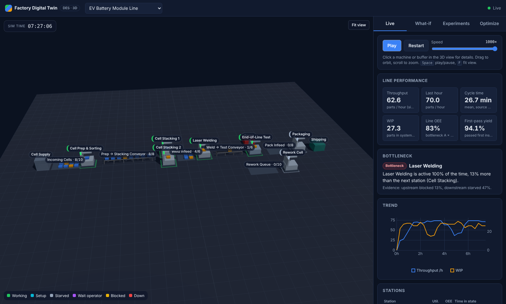
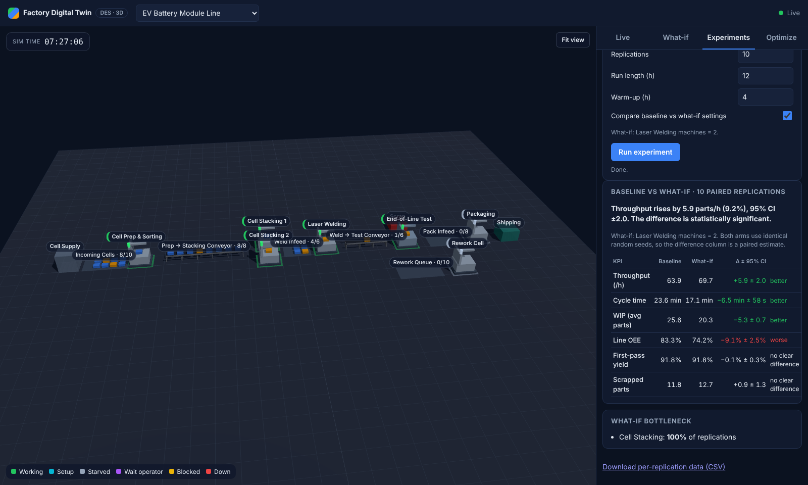
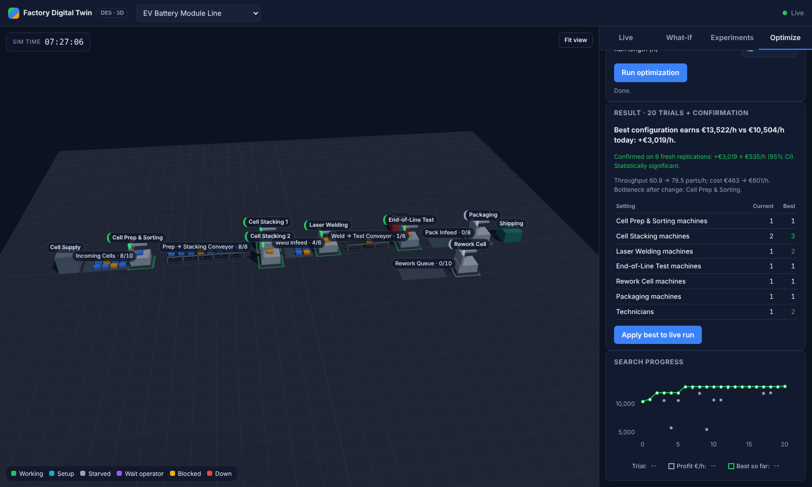
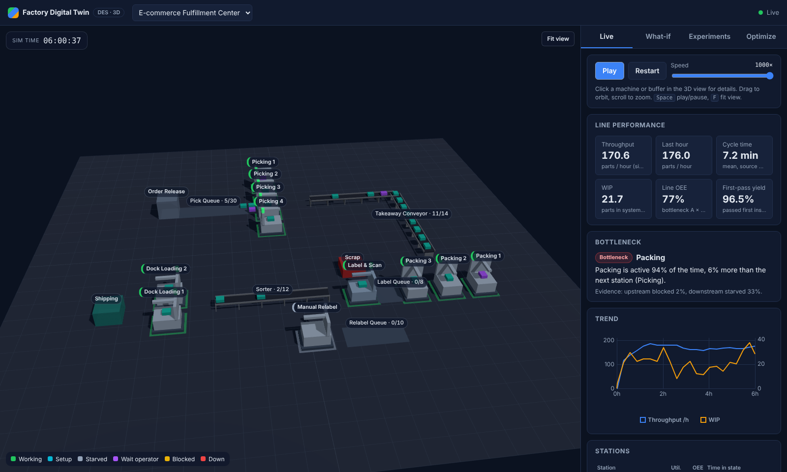
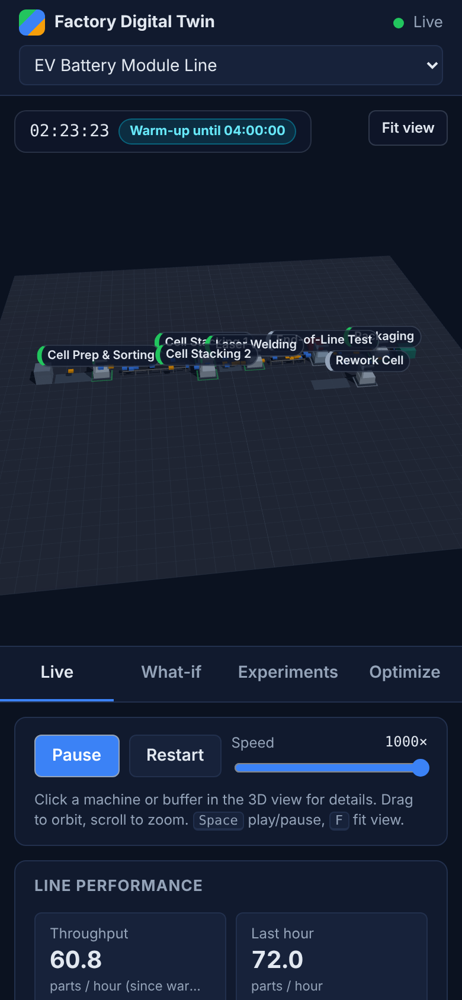
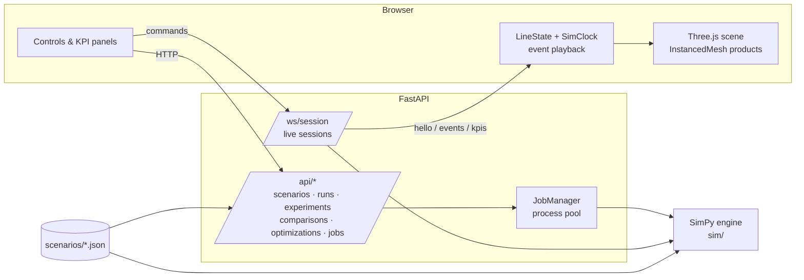

# Factory Digital Twin

**A web-based 3D discrete-event simulation (DES) of a production line, built from scratch: Python + SimPy for the engine, FastAPI for live streaming and experiments, Three.js for the 3D twin.** It covers the same workflow as commercial tools like Siemens Plant Simulation, FlexSim or AnyLogic: model the line, watch it run, find the bottleneck, test what-if changes with proper statistics, and optimize the configuration.



## Highlights

- **A DES engine validated against queueing theory.** It matches M/M/1 and M/M/c (Erlang C) results within about 1% (analytic values fall inside the simulated 95% CI). [Validation table](docs/findings.md#1-engine-validation-against-queueing-theory)
- **Realistic line behaviour:**
  - finite buffers and accumulating conveyors with blocking-after-service
  - stochastic process times and product variants with changeovers
  - preempt-resume breakdowns (MTBF/MTTR) with a shared technician pool, plus shared operators
  - QC with rework loops and scrap
- **A live 3D twin.** The scene is generated from the same JSON scenario the engine runs. Machines show their state (working / setup / starved / blocked / down), parts ride conveyors, and buffers fill up. Click any machine to inspect it or break it down on the spot.
- **Decision support:**
  - KPIs (throughput, cycle time, WIP, OEE, first-pass yield)
  - automatic bottleneck detection (active-period method)
  - a state timeline
- **Statistically sound experiments:**
  - independent replications with 95% confidence intervals
  - baseline vs what-if comparisons using **common random numbers** (paired differences)
  - **MSER** warm-up detection
  - CSV export
- **Simulation-based optimization.** Optuna (TPE) searches machine counts, buffer sizes and staffing for hourly profit. The top candidates are then **re-confirmed on fresh seeds**, so the reported gain is free of optimization bias and comes with a significance test.
- **Production engineering:**
  - typed API with input validation
  - resumable WebSocket sessions with origin checks and rate limits
  - process-pool job queue
  - 75 backend tests, 20 frontend unit tests and 7 Playwright E2E tests
  - CI, plus a single-container Docker deploy

| Experiments: paired comparison | Optimization with confirmation |
|---|---|
|  |  |

| Second scenario: fulfillment center (same engine, JSON only) | Mobile |
|---|---|
|  |  |

## Case-study results (EV battery-module line)

All numbers come from [`docs/findings.md`](docs/findings.md). The script `python -m experiments.case_study` regenerates that file with fixed seeds.

- **Bottleneck:** laser welding in 100% of replications (91% utilized, 9% down). Cell prep upstream is blocked 33% of the time; test and packaging downstream are starved about 45%.
- **Warm-up:** MSER analysis showed the start-up transient lasts about 3.75 h. The original 1 h warm-up biased every KPI, so the model now uses 4 h.
- **What-if results** (20 paired replications each):
  - **Second welder:** +6.0 ± 1.2 parts/h (+9.3%) and −6.4 min cycle time. Stacking becomes the bottleneck.
  - **Doubling the buffer in front of welding:** no throughput gain (+0.05/h), but +5.8 parts of WIP and +5.3 min lead time (Little's Law in action).
  - **Second welder plus third stacking cell:** +13.8 parts/h (+21.5%).
- **Optimization:** about +€3,100/h hourly profit (±€500, statistically significant on fresh seeds). The welder and the stacking cell carry the gain; the extra technician the search proposes is flagged as not significant.

## Quick start

### Docker (one container: API + WebSocket + built frontend)

```bash
docker compose up --build
# open http://localhost:8000
```

### Local development

```bash
# Backend (Python 3.11+)
cd backend
python -m venv ../.venv && source ../.venv/bin/activate
pip install -r requirements-dev.txt
uvicorn api.main:app --reload          # http://127.0.0.1:8000

# Frontend (Node 22), in another terminal
cd frontend
npm ci
npm run dev                             # http://localhost:5173 (proxies /api and /ws to :8000)
```

Command line, without the UI:

```bash
cd backend
python -m sim run battery_line --seed 7          # one replication, KPI table
python -m sim run fulfillment_center --json      # full KPI document
python -m experiments.case_study > ../docs/findings.md
```

## Architecture



**Two run modes.**

- **Live:** each WebSocket client owns a `SimSession`. The model advances in 50 ms real-time slices (`speed` simulated seconds per real second). Every state change in a slice goes to the client as one batched message. The client plays events back slightly behind the newest server time, so each one appears at its true simulated moment, and tweens part motion at 60 fps. Sessions survive a dropped connection for 60 s: the client reconnects with back-off and resumes the same simulation.
- **Batch:** replications run headless in a process pool, so they use every core and never block the live event loop. Experiments, comparisons and optimizations are background jobs the UI polls for progress.

**WebSocket protocol** (`backend/api/ws.py`):

| Direction | Message | Purpose |
|---|---|---|
| server → client | `hello` | full scenario + snapshot (on connect, reset, resync) |
| server → client | `events` | batched `create / enter / take / state / exit` events with sim timestamps |
| server → client | `kpis` | KPI document about once per second, plus rolling one-hour throughput |
| server → client | `status` / `error` | playing / paused / finished; human-readable errors (never stack traces) |
| client → server | `play`, `pause`, `speed`, `reset{overrides, seed}`, `inject_failure{machine, repair_time}`, `snapshot` | session control |

## The simulation model

A scenario is a JSON file (`backend/scenarios/`), validated by Pydantic (`sim/config.py`). It describes:

- variants with mix weights
- a source with an inter-arrival distribution
- buffers: queues or conveyors with capacity, transit time and path
- stations: number of machines, process time per variant, setup time, failures, operator requirement and QC routing
- shared resources and the 3D layout positions

Distributions: constant, exponential, uniform, triangular, normal (truncated), lognormal (by mean/std), Weibull.

```json
{ "id": "weld", "name": "Laser Welding", "input": "B2", "output": "C3",
  "process_time": {"type": "normal", "mean": 50, "std": 5, "min": 35},
  "failure": {"ttf": {"type": "exponential", "mean": 7200},
              "ttr": {"type": "lognormal", "mean": 600, "std": 300}} }
```

Key modelling decisions (`sim/model.py`):

- **Interrupt-safe machines.** Breakdowns are SimPy interrupts. Every place a machine can wait goes through one helper that cancels pending resource requests, so a part is never silently lost, and interrupted work resumes with its remaining time. A conservation test checks that created = completed + scrapped + WIP.
- **Blocking after service.** A finished part stays on the machine until the downstream buffer has room, so blocking spreads upstream realistically.
- **Conveyors hold capacity during transit.** A slot is released only when the part physically leaves, not when a machine first claims it.
- **Common random numbers.** Each stochastic element has its own RNG stream, seeded from the run seed plus a stable name. A design change therefore doesn't reshuffle unrelated random draws, which makes paired comparisons much sharper.

KPI definitions (`sim/kpi.py`):

- **OEE** = availability × performance × quality, where availability = (T − down − setup) / T. Starved and blocked time counts as performance loss.
- **Line OEE** is the bottleneck station's OEE.
- **Bottleneck detection** uses Roser's active-period principle: processing, setup and down count as "active". The report includes upstream-blocked and downstream-starved percentages as evidence.

## API

| Method | Path | Description |
|---|---|---|
| GET | `/api/health` | liveness + active session count |
| GET | `/api/scenarios`, `/api/scenarios/{id}` | list / full scenario (layout for 3D) |
| GET | `/api/scenarios/{id}/optimizer-defaults` | suggested search space + economics |
| POST | `/api/runs` | one replication, returns KPIs |
| POST | `/api/experiments` | N replications → 202 + job id |
| POST | `/api/comparisons` | baseline vs alternative (paired) → job |
| POST | `/api/optimizations` | Optuna search + confirmation → job |
| GET | `/api/jobs/{id}`, `/api/jobs/{id}/runs.csv` | progress / result, per-replication CSV |
| WS | `/ws/session?scenario=…&resume=…` | live session |

Only whitelisted overrides are accepted (`buffer.<id>.capacity`, `station.<id>.servers`, `resources.technicians|operators`, `source.interarrival_scale`), each with bounds. The result is re-validated as a complete scenario.

## Testing

```bash
cd backend && ruff check . && ruff format --check . && mypy sim api experiments && pytest -q
cd frontend && npm run typecheck && npm test && npm run build && npx playwright test
```

- **Engine:**
  - analytic validation (M/M/1, M/M/c, Little's Law)
  - conservation and capacity invariants
  - blocking, preempt-resume failures, failure injection on an idle machine, operator pools
  - QC routing proportions and warm-up reset
  - determinism, and every bundled scenario
- **Experiments:** CI math, paired differences, MSER (including on noisy data), CRN comparisons, the cost model, and the optimizer (finds the second welder, keeps the baseline when nothing helps, confirmation on fresh seeds).
- **API:**
  - REST validation and path-traversal attempts
  - job lifecycle and CSV export
  - WebSocket hello / play / events / inject / reset, plus resume and eviction
  - origin check and session limits
- **Frontend:** event application and ordering, the playback clock, layout geometry, reconnect and back-off, and form validation.
- **E2E (Playwright, production build):** live streaming, clicking a machine and injecting a failure, what-if restart, a replication study, scenario switching, and mobile layout.

## Project structure

```
backend/
  sim/           engine: config schema, distributions, model, monitor, KPIs, bottleneck, CLI
  experiments/   replications, statistics (CI, paired diff, MSER), optimizer, case study
  api/           FastAPI app, REST routes, WebSocket sessions, job manager, settings
  scenarios/     battery_line.json, fulfillment_center.json
  tests/
frontend/
  src/net/       WebSocket client (reconnect/resume), REST client
  src/sim/       client-side line state + playback clock
  src/scene/     Three.js scene + pure layout geometry
  src/ui/        KPI panel, charts, timeline, inspector, what-if form, experiments, optimizer
  e2e/           Playwright tests
docs/            findings.md (generated), screenshots
```

## Configuration

Environment variables (see `.env.example` and `backend/api/settings.py`):

- `CORS_ORIGINS`, `MAX_SESSIONS`, `MAX_SPEED`, `MAX_LIVE_SIM_TIME`, `SESSION_RESUME_TTL`
- `SIM_WORKERS`, `MAX_REPLICATIONS`, `MAX_OPTIMIZER_TRIALS`, `MAX_JOBS`, `MAX_BATCH_HORIZON`
- `STATIC_DIR`, `LOG_LEVEL`
- `VITE_API_URL` (frontend build), to point at a separately hosted backend

## Security notes

- Every request and WebSocket command is schema-validated with bounded sizes. Overrides are whitelisted, and scenario IDs are looked up in a directory listing, never joined into a path.
- Browsers don't apply CORS to WebSockets, so the server checks `Origin` explicitly to block cross-site WebSocket hijacking. Message size and command rate are limited.
- Limits on sessions, simulated time, replications, trials and concurrent jobs keep the server's CPU and memory bounded.
- Errors returned to clients are plain sentences. Details go to structured logs with request IDs.
- The container runs as a non-root user.

## Limitations and roadmap

- **Routing:** flow is buffer → station, with one consumer per buffer. Assembly/merge stations (kitting several parts into one), AGVs and shift calendars are natural next steps.
- **Failures:** time-to-failure runs on calendar time. Operation-based failures would be more accurate for machines with long idle periods.
- **Persistence:** sessions and jobs live in memory, so a restart loses them. A Redis-backed job store would allow horizontal scaling.
- **3D models:** geometry is procedural (boxes). glTF models could replace it without touching the rest of the pipeline.
